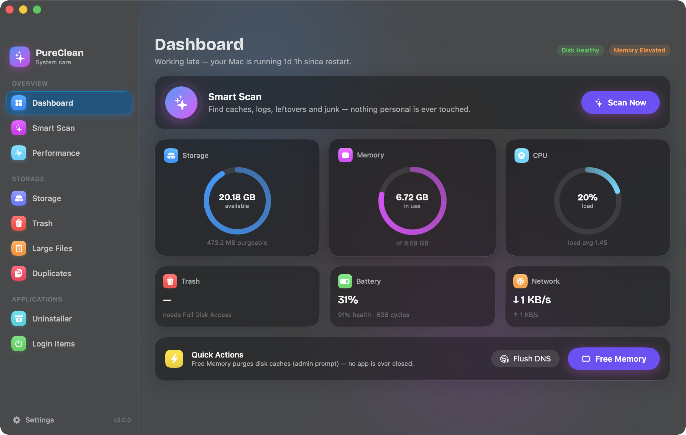
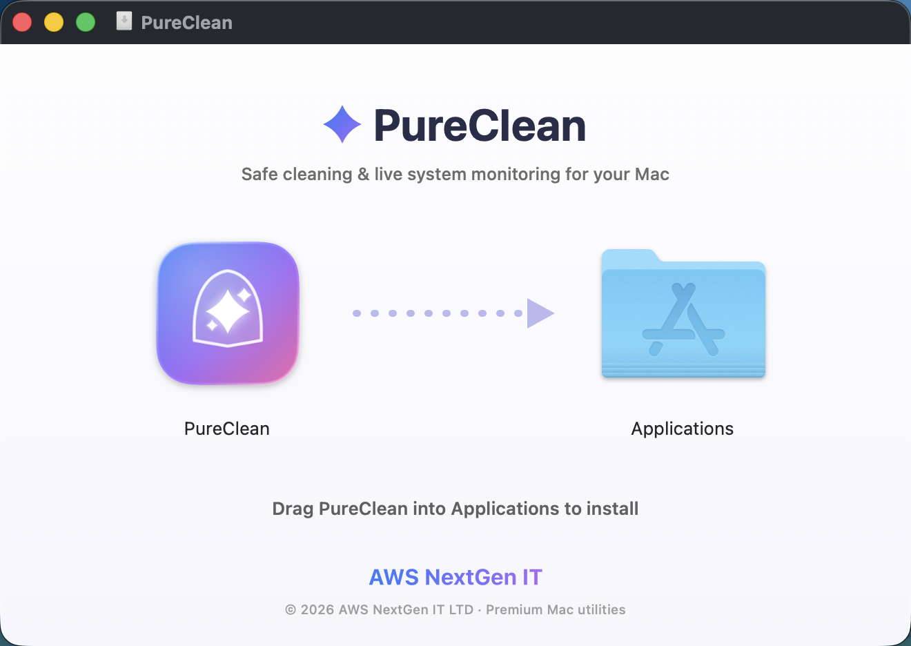
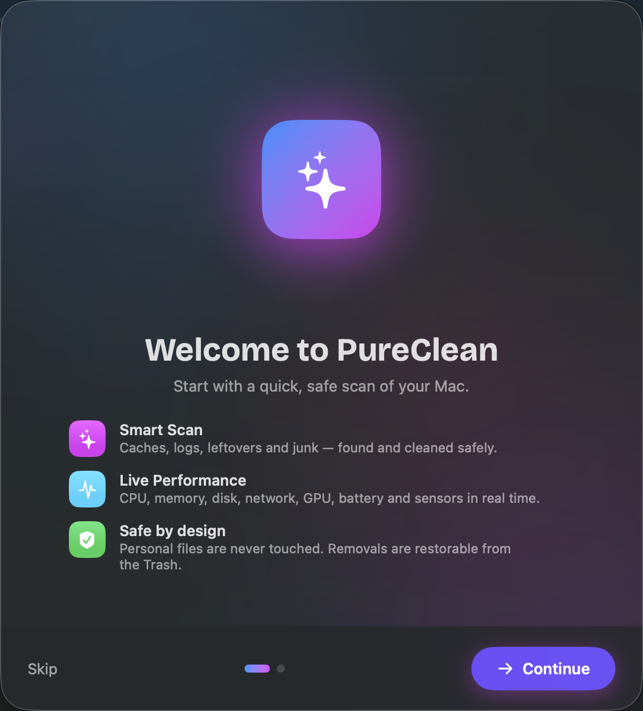
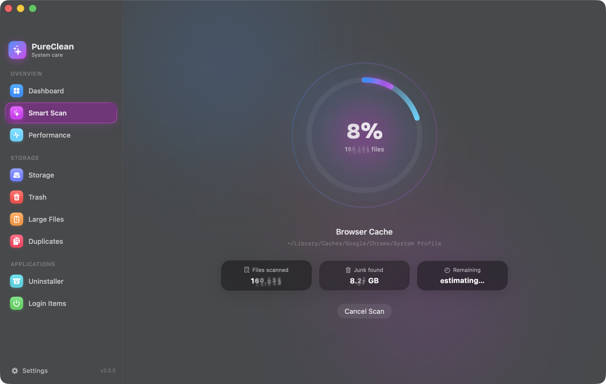
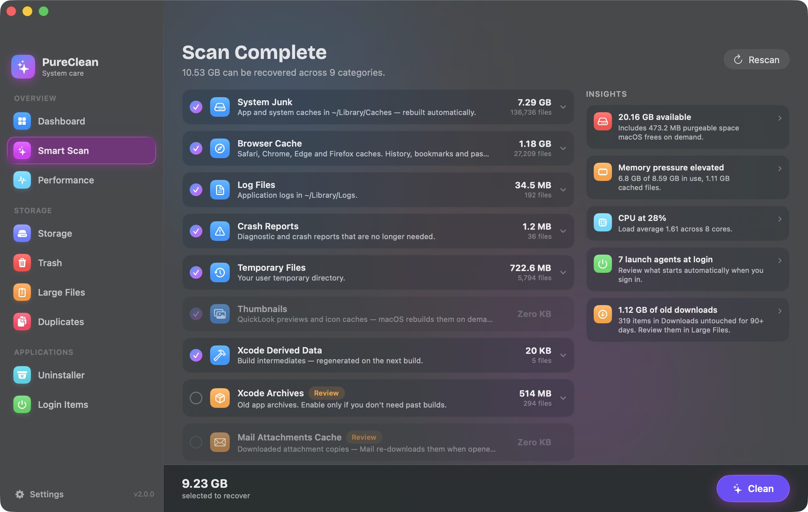
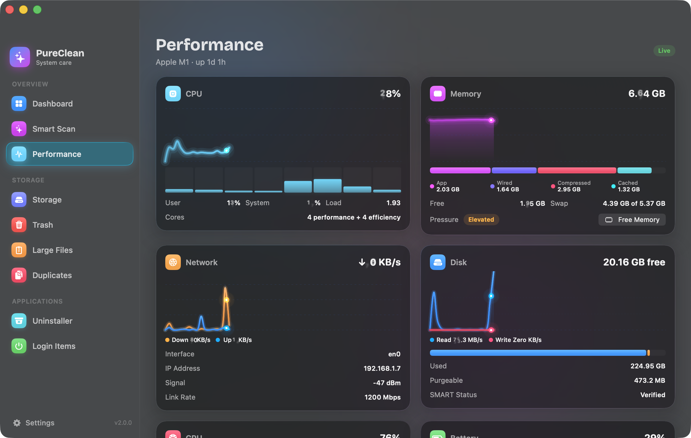
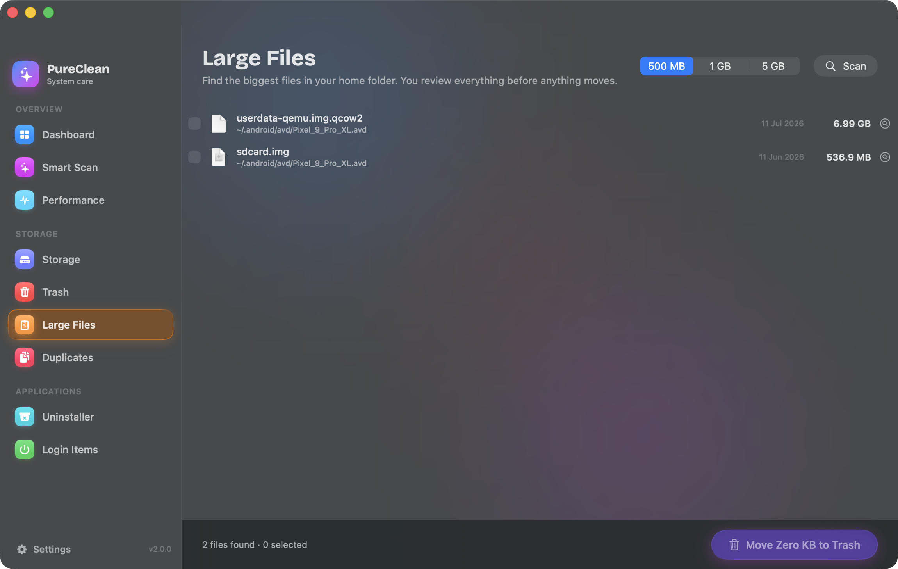

<p align="center">
  
</p>

<h1 align="center">PureClean</h1>

<p align="center">
  <b>Safe cleaning & live system monitoring for your Mac.</b><br/>
  A native SwiftUI app with Liquid Glass design — personal files are never touched.
</p>

<p align="center">
  <a href="https://drive.google.com/file/d/1jKzxVM180lpHmlZuK9EkDToAQ02LKdAa/view?usp=sharing">
    
  </a>
  
  
</p>

<p align="center">
  
</p>

---

## 📦 Installation

1. **[Download PureClean.dmg](https://drive.google.com/file/d/1jKzxVM180lpHmlZuK9EkDToAQ02LKdAa/view?usp=sharing)**
2. Open the DMG and **drag PureClean into Applications**
3. Launch PureClean — the welcome guide asks for the permissions once, up front

<p align="center">
  
</p>

> **Full Disk Access** is optional but recommended — macOS protects the Trash,
> Safari and Mail caches behind it. The setup screen deep-links you to the
> right System Settings pane, and PureClean tells you honestly when a number
> is unavailable instead of showing a fake zero. After granting it, restart
> the app (macOS only applies the permission to a fresh launch — PureClean
> has a one-click **Restart** button for exactly this).

<p align="center">
  
</p>

---

## ✨ Smart Scan

One click inspects **13 categories**: system junk, browser caches (Safari,
Chrome, Edge, Firefox, Brave, Opera), logs, crash reports, temporary files,
thumbnails, Xcode derived data & archives, Mail attachment caches, old
installers, **app leftovers** from uninstalled apps, broken symlinks, and the
Trash.

The scanner is fully live — real file counter, junk-found counter, the exact
path being inspected, and a time estimate:

<p align="center">
  
</p>

Then you review everything before cleaning. Safe categories are pre-selected;
anything sensitive is tagged <b>Review</b> and starts unticked. The insights
column surfaces what a cleaner can't fix but you should know — memory
pressure, login items, old downloads, battery health:

<p align="center">
  
</p>

Cleaned items go to the **Trash whenever possible, so everything is
restorable** — and the app never offers language-file stripping, because
removing `.lproj` folders breaks app code signatures on modern macOS.

---

## 📊 Live Performance Monitor

Every value refreshes each second, straight from native APIs — nothing is
estimated or invented:

<p align="center">
  
</p>

| Panel | What you get |
|---|---|
| **CPU** | Total / user / system %, per-core activity bars, load average, P+E core layout |
| **Memory** | Used / app / wired / compressed / cached (Activity-Monitor math), swap, kernel pressure level |
| **Network** | Live down/up throughput graph, interface, IP address, Wi-Fi signal & link rate |
| **Disk** | Read/write speed graph (IOKit block-storage counters), capacity, purgeable space, SMART status |
| **GPU** | Chip name, utilization and memory when the driver exposes them |
| **Battery** | Charge, health %, cycle count, real mAh capacities, temperature, time remaining |
| **Sensors** | Fan RPM and CPU/GPU temperature via the SMC — per-model key discovery, honest "not available" on Macs that expose nothing |

---

## 🧰 The full toolbox

- **Storage** — Finder-accurate APFS numbers (total / used / **purgeable** /
  free) with a folder-by-folder breakdown donut.
- **Trash** — live size across *all* volumes (updates via a kernel file
  watcher), item preview, safe one-click empty. Trashed `.app` bundles are
  measured correctly, packages included.
- **Free Memory (RAM cleaner)** — one click from the Dashboard's Quick
  Actions row, the Performance memory card, or the menu bar. It asks the
  kernel to purge its disk caches via `/usr/sbin/purge` (admin prompt
  explains why), then reports exactly how much RAM became free — e.g.
  *"Freed 1.2 GB on the last run"*. **No app is ever force-quit.**
- **Flush DNS** — a Quick Action next to Free Memory that clears the DNS
  cache to fix stale name-resolution issues.
- **Large Files** — scans your home folder for files over 500 MB / 1 GB /
  5 GB, **including hidden developer folders** (`~/.gradle`, `~/.android`,
  `~/.npm`…) and app packages like Photos libraries. Everything is listed
  with size, location and date so you can tick the ones to remove — ticked
  files move to the Trash, never hard-deleted.

  <p align="center">
    
  </p>
- **Duplicates** — SHA-256 byte-for-byte verification, so false matches are
  impossible; at least one copy of every file is always kept.
- **Uninstaller** — removes an app together with its caches, preferences,
  containers and support files, with a full preview before anything moves.
- **Login Items** — see and toggle what launches at sign-in.
- **Menu bar** — PureClean keeps running in the menu bar when the window
  closes: live CPU/memory/disk status, Quick Scan, Free Memory, Trash size,
  Settings, Quit. Launch-at-login optional.

---

## 🛡️ Safety model

Every destructive operation passes through a single gatekeeper
(`SafetyGuard`):

- Deletions are only allowed inside an **allow-list** of cache/log/temp roots.
- Forbidden path components (`Documents`, `Desktop`, `Pictures`, `.git`,
  `.ssh`, …) are refused anywhere, always.
- User-reviewed removals (large files, duplicates, uninstaller, leftovers)
  are **always trashed, never hard-deleted**.

---

## 🔨 Building from source

```bash
brew install xcodegen
xcodegen generate            # project.yml → PureClean.xcodeproj
open PureClean.xcodeproj     # ⌘R, or:
xcodebuild -project PureClean.xcodeproj -scheme PureClean -configuration Release build
```

**Package the installer** (Release build → branded, Retina-sharp DMG):

```bash
./build-dmg.sh               # → dist/PureClean.dmg
```

All artwork is generated from code — `make-icon.swift` renders the full app
icon set, `make-dmg-background.swift` renders the installer background as a
vector PDF.

---

<p align="center">
  Crafted by <b>AWS NextGen IT</b><br/>
  <sub>© 2026 AWS NextGen IT LTD · Premium Mac utilities</sub>
</p>
